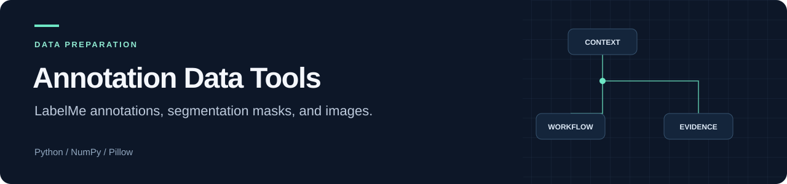

<div align="center">



# Annotation Data Tools

**Small Python utilities for LabelMe annotations and segmentation-data preparation.**

**English** · [简体中文](README.zh-CN.md)

[Quick start](#quick-start) · [Scripts](#scripts) · [Examples](#examples)

</div>

Merge annotation sets, select images by labels, convert LabelMe shapes to masks, inspect image modes, and convert images to grayscale. Run the individual scripts listed below; `main.py` is an IDE starter file.

## Quick start

Use Python 3.10 or newer and install the image-processing dependencies:

```bash
git clone https://github.com/victoryloser/process_data.git
cd process_data
python -m pip install numpy pillow
```

Each command-line tool provides `--help`. Choose explicit input and output directories for your dataset.

## Scripts

| Script | Purpose |
|---|---|
| [`Merge_labelme.py`](Merge_labelme.py) | Merge matching LabelMe files and handle conflicting label names |
| [`merge_part_json.py`](merge_part_json.py) | Extract selected classes from two annotation sets and merge them |
| [`filter_labels.py`](filter_labels.py) | Select annotations containing both requested labels and copy matching images |
| [`json2mask.py`](json2mask.py) | Generate numeric masks, color previews, and a label map |
| [`rgb_or_L.py`](rgb_or_L.py) | Inspect image and mask modes |
| [`rgb2L.py`](rgb2L.py) | Convert images to grayscale |
| [`json_filter.py`](json_filter.py) | Copy annotations/images for a configured target class; edit its path settings before running |

## Examples

Merge two annotation directories:

```bash
python Merge_labelme.py --dir_a annotations_a --dir_b annotations_b --out merged_annotations
```

Create segmentation masks:

```bash
python json2mask.py --json_dir merged_annotations --out_dir masks_output
```

Inspect image modes and create a separate grayscale output:

```bash
python rgb_or_L.py --img_dir images --mask_dir masks_output
python rgb2L.py --input_dir images --output_dir grayscale_images
```

The examples use separate output directories. Use the scripts' help text to inspect options such as label renaming, class selection, and in-place conversion before choosing them.

LabelMe inputs should contain shape labels/points and the image dimensions expected by the mask converter. Image files and annotation files should use matching stems when copied together.

Part of [victoryloser's applied-AI projects](https://github.com/victoryloser).
