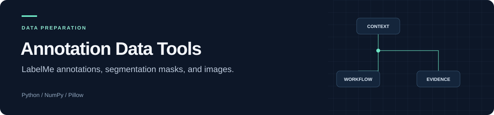

<div align="center">



# 图像标注处理工具

**面向 LabelMe 标注与分割数据准备的小型 Python 工具集。**

[English](README.md) · **简体中文**

</div>

支持合并标注、按标签筛选数据、生成分割 mask、检查图像模式和灰度转换。按下表运行对应脚本；`main.py` 是 IDE 初始示例文件。

## 快速开始

使用 Python 3.10 或更新版本：

```bash
git clone https://github.com/victoryloser/process_data.git
cd process_data
python -m pip install numpy pillow
```

命令行工具可通过 `--help` 查看参数。运行时明确指定输入和输出目录。

## 脚本索引

| 脚本 | 用途 |
|---|---|
| [Merge_labelme.py](Merge_labelme.py) | 合并同名 LabelMe 文件，处理冲突标签名 |
| [merge_part_json.py](merge_part_json.py) | 从两套标注中提取指定类别并合并 |
| [filter_labels.py](filter_labels.py) | 筛选同时包含两个指定标签的标注，并复制对应图像 |
| [json2mask.py](json2mask.py) | 生成数值 mask、彩色预览与标签映射 |
| [rgb_or_L.py](rgb_or_L.py) | 检查图像和 mask 的颜色模式 |
| [rgb2L.py](rgb2L.py) | 批量将图像转换为灰度图 |
| [json_filter.py](json_filter.py) | 按指定类别复制标注与图像，运行前编辑脚本中的路径配置 |

## 使用示例

```bash
# 合并标注
python Merge_labelme.py --dir_a annotations_a --dir_b annotations_b --out merged_annotations

# 生成 mask
python json2mask.py --json_dir merged_annotations --out_dir masks_output

# 检查图像模式
python rgb_or_L.py --img_dir images --mask_dir masks_output

# 输出灰度图到单独目录
python rgb2L.py --input_dir images --output_dir grayscale_images
```

示例使用独立输出目录。标签重命名、类别筛选和原地覆盖等选项，以各脚本的 `--help` 为准。

生成 mask 时，LabelMe JSON 需包含脚本要求的图像尺寸、形状标签和坐标。需要成对复制时，图像与标注使用相同文件名主干。

[返回个人项目主页](https://github.com/victoryloser)
